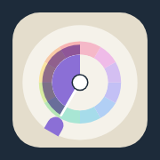
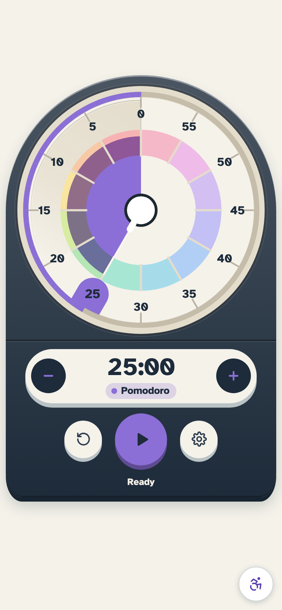
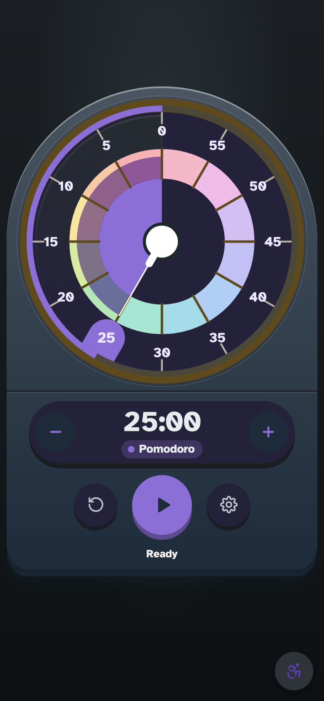
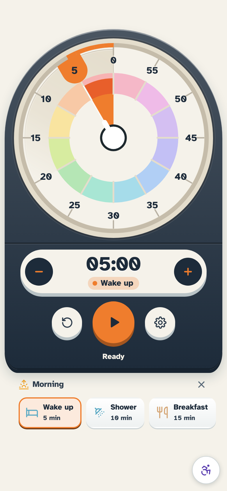
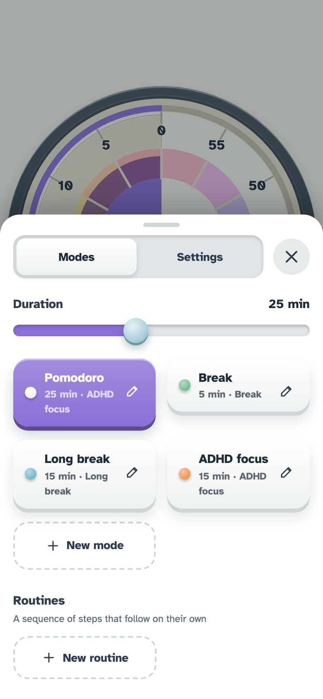

&nbsp;&nbsp;&nbsp;&nbsp;

 

# Pomodoro Accessibilité

**Un minuteur visuel pour l'autisme, le TDAH, les troubles DYS et les autres profils neurodivergents.**
On voit le temps qui reste au lieu de le lire.

&nbsp;&nbsp;

---

## Sommaire

- [Pourquoi un minuteur visuel ?](#pourquoi-un-minuteur-visuel-)
- [Ce que fait l'application](#ce-que-fait-lapplication)
- [Téléchargements](#téléchargements)
- [Comment s'en servir](#comment-sen-servir)
- [Les sons](#les-sons)
- [Accessibilité](#accessibilité)
- [Pour les développeurs](#pour-les-développeurs)

## Pourquoi un minuteur visuel ?

Une horloge donne l'heure, un minuteur numérique affiche des chiffres, mais aucun des deux
ne **montre** vraiment le temps. Pomodoro Accessibilité reprend le principe du minuteur visuel : un
disque coloré couvre la durée choisie et **rétrécit à mesure que le temps passe**. D'un
coup d'œil, on sait s'il reste beaucoup ou peu de temps, sans lire ni calculer.

Ce repère concret aide particulièrement les personnes **TDAH, autistes ou neurodivergentes** :

- 🧭 **Rendre le temps concret** : une durée abstraite devient une surface qui diminue.
- 🔄 **Faciliter les transitions** : trois paliers annoncés avant la fin, calculés sur la durée
  choisie, puis le carillon : on sait qu'un changement d'activité approche.
- 🌱 **Favoriser l'autonomie** : on gère soi-même son temps de travail ou de pause, sans
  qu'un adulte ou un collègue ait à le rappeler.
- ⏰ **Ne pas dépendre d'y penser** : une routine peut se rappeler d'elle-même, à l'heure et
  les jours choisis - ne pas remarquer qu'il est l'heure est justement la difficulté.
- 🏠 **Au quotidien** : devoirs, routines du matin, temps d'écran, séances de travail en
  Pomodoro, à la maison comme en classe ou au bureau.

### Neurodiversité : quelques repères

- **Neurodivergent** : personne dont le fonctionnement neurologique diverge des normes
  sociétales. Une personne autiste, ayant un TDAH ou dyslexique est considérée comme
  neurodivergente.
- **Neurotypique** : personne dont le fonctionnement neurologique correspond aux normes
  dominantes de la société.

Le concept de neurodiversité intègre ainsi l'idée que certains cerveaux perçoivent et comprennent
le monde différemment, et qu'il convient aussi de reconnaître leurs forces : créativité, pensée en
arborescence, pensée systémique, persévérance, honnêteté.

### Le temps, difficile à ressentir

Pour beaucoup de personnes neurodivergentes, le temps ne se « sent » pas : dix minutes et une
heure peuvent paraître identiques, et regarder l'heure n'aide pas toujours à savoir combien il
reste. Ce n'est ni un manque de volonté ni de la mauvaise humeur : c'est une autre façon de
percevoir la durée. Un disque qui rétrécit remplace un calcul par une image.

**TDAH** - estimer la durée, démarrer, s'arrêter à temps.
→ Un repère visuel, des sessions courtes suivies de pauses, un mode *Focus TDAH*.

**Autisme** - passer d'une activité à une autre, supporter l'imprévu et le bruit.
→ Des paliers annoncés à l'avance, des routines en images, des sons doux et désactivables.

**Troubles DYS** - lire des chiffres ou une heure, se fatiguer sur le texte.
→ Un temps lisible sans chiffres, la police OpenDyslexic, un texte bien espacé.

**Autres profils** - besoin de consignes claires, d'un rythme adapté, de moins de pression.
→ Des durées libres de 1 à 60 min, des modes personnalisés, aucune note ni sanction.

### Un outil sans pression

- **Pas de jugement** : aucun score punitif.
- **Une fin en douceur** : à 0, cinq minutes de plus peuvent s'ajouter pour terminer sans être brusqué.
- **Le contrôle reste à la personne** : sons, vibration et écran allumé se coupent ou se règlent.
- **Un affichage calme** : pas de clignotement, animations réduites si l'appareil le demande.

### Aussi dans le monde professionnel

La neurodiversité concerne aussi les équipes : créativité, pensée en arborescence, persévérance
et rigueur sont des atouts reconnus, à condition que l'environnement de travail ne dresse pas
d'obstacles inutiles. Un minuteur visuel est un outil simple, discret et sans coût à ce niveau.

- 🎯 **Sessions de concentration** : découper une tâche en blocs Pomodoro avec des pauses, sans
  dépendre du regard d'un collègue ou d'un manager.
- 🔄 **Enchaîner les tâches** : trois paliers avant la fin, y compris sur une session courte,
  aident à conclure et à changer de sujet sans coupure brutale.
- 🤝 **Réunions et entretiens** : garder une durée visible pour tous, qui rassure et cadre l'échange.
- 🎧 **Bureau ou télétravail** : vibration et notifications discrètes, sons désactivables en
  open space.
- 🧰 **Un aménagement simple** : à proposer avec les autres aménagements de poste, sans exposer
  la situation de la personne, puisque l'outil sert à tout le monde.

## Ce que fait l'application

### Le cadran

- 🕒 **Un cadran qui se vide** - un disque coloré recule vers 0, avec un anneau arc-en-ciel en
  12 segments de 5 min, jusqu'à 60 min
- 👆 **Réglage au doigt** - il suffit de glisser sur le cadran pour choisir les minutes, même
  pendant le décompte
- ➖➕ **Boutons − et +** - une minute par appui, sans glisser : pour les mains qui tremblent,
  un seul doigt ou un contacteur
- 💪 **Cadran en secondes** - sous la minute, la graduation passe en secondes : un effort de 20 s
  se vide sous les yeux au lieu d'être un filet

### Modes et routines

- 🎯 **Modes personnalisables** - Pomodoro, Pause, Pause longue, Focus TDAH… ou tes propres
  modes : nom, durée (1-60 min), couleur, travail ou pause
- 🧩 **Routines en pictogrammes** - une suite d'étapes qui s'enchaînent - s'habiller,
  petit-déjeuner, dents, cartable - chacune avec son image et sa durée
- 🔁 **Tours et secondes** - une étape dure de 5 s à 60 min, une routine se rejoue jusqu'à
  20 fois : « effort 20 s, repos 10 s » × 8, c'est un Tabata
- 🎨 **Mode sport** - une routine marquée *entraînement* teinte toute la page de la couleur de
  l'étape : rouge à l'effort, vert au repos
- ⏰ **Rappel de routine** - une heure, des jours : la notification arrive à l'heure dite et ouvre
  la routine, prête à démarrer
- 🔁 **Enchaînement automatique** - travail → pause → travail, avec une pause longue tous les
  4 cycles (désactivable)

### Les alertes

- 🔔 **Sons de palier** - trois paliers avant la fin, calculés sur la durée réglée, chacun son
  son, puis un carillon
- 3️⃣ **Décompte des 3 dernières** - un tic, une impulsion et un éclat par seconde, et la suite
  annoncée avant la fin : finir son effort sans regarder
- 💡 **Alerte visuelle** - un éclat coloré aux paliers et à la fin, doux ou franc, pour qui
  n'entend pas ou a coupé le son
- 🗣️ **Annonce vocale** - le temps restant dit à voix haute, aux paliers ou à chaque minute, pour
  écouter sans regarder (désactivé par défaut)
- 📳 **Vibration codée** - un motif différent par palier : 1 impulsion au premier, 2 au deuxième,
  3 brèves au dernier, 3 longues à la fin (désactivable)
- 📲 **Notifications** - alertes même téléphone verrouillé ou application en arrière-plan, avec
  les mêmes sons que l'application
- 🧪 **Test de notification** - un bouton programme une notification à cinq secondes : le temps de
  verrouiller l'écran, et de savoir avant d'en avoir besoin si l'appareil prévient
- ⏱️ **+5 min automatique** - à 0, cinq minutes de plus pour terminer ce qui est en cours
  (désactivable)

### Hors de l'application

- 🧩 **Widget Android** - le cadran lui-même sur l'écran d'accueil : le disque s'y vide minute par
  minute, et le widget affiche aussi l'objectif du jour
- ⏱️ **Décompte sur l'écran verrouillé** - une notification muette sur Android : le temps restant
  sans déverrouiller
- 🔆 **Écran toujours allumé** - l'écran ne s'éteint pas pendant le décompte (désactivable)

### Confort et réglages

- 👋 **Tutoriel d'accueil** - cinq vues au premier lancement : voir le temps, le régler, le
  lancer, les routines, les alertes
- 🌍 **7 langues** - français, anglais, espagnol, allemand, italien, portugais, arabe (lu de
  droite à gauche)
- 🌗 **Mode sombre** - suit le réglage de l'appareil, puis modifiable dans ⚙︎
- 🔇 **Son on/off** - coupure complète des sons, choix mémorisé

Le décompte reste juste même si l'application passe en arrière-plan ou si le téléphone se
verrouille : au retour, tout est à jour.

## Téléchargements

Récupère la dernière version sur la [page des releases](https://github.com/maximejolivet/pomodoro-accessibility/releases/latest) :

- **macOS (Apple Silicon)** : `Pomodoro-TDAH-1.0.0-arm64.dmg`
- **Windows (64 bits)** : `Pomodoro-TDAH-Setup-1.0.0.exe`
- **Android** : `Pomodoro-TDAH-1.0.0.apk`

Les installeurs macOS et Windows ne sont pas encore signés par un certificat. macOS demande une
confirmation au premier lancement (clic droit sur l'app, puis Ouvrir). Windows SmartScreen affiche
un avertissement : clique sur *Informations complémentaires*, puis *Exécuter quand même*.

## Comment s'en servir

| Geste                        | Action                                                                                                    |
| ---------------------------- | --------------------------------------------------------------------------------------------------------- |
| **Toucher** le cadran ou ▶   | Démarrer, mettre en pause ou reprendre                                                                    |
| **Glisser** sur le cadran    | Régler les minutes (0 → 60)                                                                               |
| **−** / **+** sous le cadran | Retirer ou ajouter une minute ; appui maintenu pour défiler                                               |
| ↺                            | Remettre à zéro                                                                                           |
| ⚙︎ → **Modes**                | Choisir, créer, modifier ou supprimer un mode                                                             |
| ⚙︎ → **Modes** → *Routines*   | Lancer une routine, en créer une, réordonner ses étapes                                                   |
| ⚙︎ → **Modes** → ✎ → *Tours*  | Rejouer la suite d'étapes : huit tours pour un Tabata                                                     |
| ⚙︎ → **Modes** → ✎ → *Rappel* | Régler l'heure et les jours où la routine vient se rappeler à toi                                         |
| **Toucher** une étape        | Aller directement à cette étape de la routine ; ✕ pour quitter la routine                                 |
| ⚙︎ → **Réglages**             | Mode sombre, sons, vibration, alerte visuelle, annonce vocale, +5 min, enchaînement, écran allumé, langue |

  
  &nbsp;&nbsp;
  
  &nbsp;&nbsp;

## Les sons

Ils vont du plus discret au plus insistant à mesure que la fin approche.

| Moment             | Son                                    | Vibration            |
| ------------------ | -------------------------------------- | -------------------- |
| **1ᵉʳ palier**     | 1 note douce et ronde                  | 1 impulsion longue   |
| **2ᵉ palier**      | 2 notes montantes, un peu plus claires | 2 impulsions         |
| **Dernier palier** | 3 notes rapides, façon « bip »         | 3 impulsions brèves  |
| **0**              | Un carillon joué 3 fois                | 3 impulsions longues |

Les paliers tombent à 45, 30 et 15 min restantes sur une session de plus de 40 min. En dessous,
ils se calculent sur la durée choisie - la moitié, le dernier quart, puis 1 min avant la fin -
sinon un Pomodoro de 25 min ne serait prévenu qu'une fois, et une étape de routine de 10 min
jamais.

Les quatre sortent au même volume, près du maximum : ce qui monte d'un palier au suivant, c'est
le motif et le timbre, pas le niveau. Un premier palier discret serait un palier manqué.

⚠️ **Sur Android, deux curseurs de volume entrent en jeu** : les sons joués par l'application
suivent le volume **multimédia**, ceux des notifications (écran verrouillé, app en arrière-plan)
suivent le volume **notifications**. Si les sons paraissent faibles pendant une session, c'est le
multimédia qu'il faut monter - le système choisit lui-même le curseur, l'app n'y peut rien.

La vibration suit le même rythme que le son : elle prévient sans rien montrer ni faire
entendre - en réunion, en cours, en open space - et reste le seul canal d'alerte pour une
personne sourde-aveugle. Elle demande un téléphone ou une tablette (iOS et Android ; sur le
web, seul Android vibre).

## Accessibilité

L'application est pensée pour être utilisable par tout le monde :

- 💻 **Au clavier seul** : tout se fait sans souris, avec un repère visible sur l'élément actif.
- 🔊 **Avec un lecteur d'écran** : le temps qui reste et les changements sont annoncés à voix haute.
- 💡 **Sans le son** : un éclat coloré marque les paliers et la fin, et un bandeau « Temps écoulé »
  reste affiché jusqu'à la prochaine action. La pulsation est lente - un battement de 1,6 s, soit
  0,6 Hz, cinq fois sous le seuil des trois éclats par seconde qui peuvent déclencher une crise
  d'épilepsie photosensible (WCAG 2.3.1) - et elle se fige si l'appareil demande moins de mouvement.
- 🗣️ **Sans regarder le cadran** : l'annonce vocale dit le temps restant aux paliers ou à chaque minute,
  avec la voix de l'appareil, hors ligne (⚙︎ → *Annonce vocale*).
- 📳 **Sans voir ni entendre** : chaque palier a son motif de vibration, reconnaissable dans la main
  (⚙︎ → *Vibration*).
- 👁️ **Lisible pour tous** : contrastes soignés, mode sombre, couleurs toujours accompagnées d'un nom.
- 🖼️ **Sans savoir lire** : chaque étape d'une routine porte un pictogramme avant son nom, et la
  bande montre ce qui est fait, ce qui se joue et ce qui vient après.
- 🔤 **Police pour la dyslexie** : la police OpenDyslexic peut être activée dans les réglages.
- 🌀 **Animations réduites** : si ton appareil demande moins de mouvement, l'application le respecte.
- 🖐️ **Sans glisser** : les boutons − et + règlent la durée en un seul appui, pour qui ne peut pas
  maintenir un glissement (WCAG 2.5.7), avec des cibles d'au moins 44 px.

Une page dédiée détaille tout cela, avec la déclaration d'accessibilité RGAA 4.1 au plan du
décret n° 2019-768 (engagement, état de conformité, résultats des tests, contenus non
accessibles, établissement de la déclaration, contact et voies de recours) : lien
**♿ Accessibilité** en bas à droite de l'application. L'application est **conforme** aux normes
**WCAG 2.1 Niveau AA** et **RGAA 4.1**, vérifiées par audit automatisé (axe-core) et tests
fonctionnels complets. La déclaration est publiée volontairement - l'application n'entre pas
dans le champ de l'article 47 de la loi n° 2005-102.

Ces acquis sont vérifiés à chaque modification : `npm run test:a11y` rejoue soixante-douze
contrôles (axe-core sur toutes les vues, en clair, en sombre et en arabe ; réglage du cadran au
clavier et aux boutons − / + ; annonce vocale, motifs de vibration et alerte visuelle vérifiés sur
un décompte simulé, paliers d'une session courte comprise ; cadran en secondes, décompte des
trois dernières et enchaînement des tours ; tutoriel d'accueil au clavier, en arabe et sans
fuite du focus ; enchaînement des étapes d'une routine, sa bande et son
éditeur ; taille des cibles ; piège à focus de la modale ; pas de défilement horizontal à 320 px),
et la CI les relance à chaque push.

## Pour les développeurs

La documentation est dans le dossier [`docs/`](docs/00_INDEX.md). Chaque document est en français, suivi de sa traduction anglaise :

- [Index de la documentation](docs/00_INDEX.md)
- [Brief projet](docs/01_PROJECT_BRIEF.md)
- [PRD : exigences produit](docs/02_PRD.md)
- [Architecture](docs/03_ARCHITECTURE.md)
- [TRD : choix techniques, build mobile, installation et commandes](docs/04_TRD.md)
- [Schéma des données](docs/05_DATA_SCHEMA.md)
- [Parcours de l'appli](docs/06_APP_FLOW.md)
- [Design UI/UX](docs/07_UI_UX_DESIGN.md)
- [Epics et user stories](docs/08_EPICS.md)
- [Plan d'implémentation](docs/09_IMPLEMENTATION_PLAN.md)
- [Kanban](docs/10_KANBAN.md)
- [Feuille de route](ROADMAP.md)

 

  

 

# Pomodoro Accessibilité

**A visual timer for autism, ADHD, DYS disorders and other neurodivergent minds.**
You see the time that's left instead of reading it.

&nbsp;&nbsp;

---

## Contents

- [Why a visual timer?](#why-a-visual-timer)
- [What the app does](#what-the-app-does)
- [Download](#download)
- [How to use it](#how-to-use-it)
- [Sounds](#sounds)
- [Accessibility](#accessibility)
- [For developers](#for-developers)

## Why a visual timer?

A clock tells the time and a digital timer shows numbers, but neither really **shows** time.
Pomodoro Accessibilité follows the visual timer principle: a colored disc covers the chosen duration
and **shrinks as time goes by**. At a glance, you know whether there's a lot or a little time
left, without reading or calculating anything.

This concrete cue is especially helpful for people who are **ADHD, autistic or neurodivergent**:

- 🧭 **Make time concrete**: an abstract duration becomes a surface that shrinks.
- 🔄 **Ease transitions**: three milestones announced before the end, worked out from the chosen
  duration, then a closing chime: you know a change of activity is coming.
- 🌱 **Encourage autonomy**: you manage your own work or break time, with no adult or
  colleague needing to remind you.
- ⏰ **No need to remember**: a routine can remind you of itself, at the time and on the days
  you choose - not noticing that it is time is precisely the difficulty.
- 🏠 **Every day**: homework, morning routines, screen time, Pomodoro work sessions, at home,
  in class or at the office.

### Neurodiversity: a few definitions

- **Neurodivergent**: a person whose neurological functioning diverges from societal norms. An
  autistic person, or someone with ADHD or dyslexia, is considered neurodivergent.
- **Neurotypical**: a person whose neurological functioning matches the dominant norms of
  society.

The concept of neurodiversity thus includes the idea that some brains perceive and understand the
world differently, and that their strengths should also be recognized: creativity, branching
thinking, systems thinking, perseverance, honesty.

### Time is hard to feel

For many neurodivergent people, time does not "feel" like anything: ten minutes and an hour can
seem the same, and looking at a clock does not always tell how much is left. This is not a
lack of willpower or a bad mood; it is a different way of perceiving duration. A shrinking
disc replaces a calculation with an image.

**ADHD** - estimating duration, starting, stopping on time.
→ A visual cue, short sessions followed by breaks, a *Focus TDAH* mode.

**Autism** - switching activities, coping with the unexpected and with noise.
→ Milestones announced in advance, routines in pictures, soft sounds that can be turned off.

**DYS disorders** - reading numbers or a clock time, tiring quickly on text.
→ Time you can read without numbers, the OpenDyslexic font, well-spaced text.

**Other profiles** - need for clear instructions, an adapted pace, less pressure.
→ Free durations from 1 to 60 min, custom modes, no grades or penalties.

### A tool without pressure

- **No judgment**: no punitive score.
- **A gentle ending**: at 0, five more minutes can be added to finish without being rushed.
- **The person stays in control**: sounds, vibration and the always-on screen can be turned off or adjusted.
- **A calm display**: no flashing, reduced animations if the device asks for it.

### In the workplace too

Neurodiversity concerns teams as well: creativity, branching thinking, perseverance and rigor
are recognized strengths, provided the work environment does not add needless obstacles. A
visual timer is a simple, discreet and free tool at that level.

- 🎯 **Focus sessions**: split a task into Pomodoro blocks with breaks, without depending on a
  colleague's or manager's watchful eye.
- 🔄 **Switching tasks**: three milestones before the end, short sessions included, help wrap
  up and change topic without an abrupt cut.
- 🤝 **Meetings and interviews**: keep a duration visible to everyone, which reassures and
  frames the exchange.
- 🎧 **Office or remote work**: discreet vibration and notifications, sounds that can be
  turned off in an open space.
- 🧰 **A simple accommodation**: to offer alongside other workplace adjustments, without
  singling anyone out, since the tool is useful to everyone.

## What the app does

### The dial

- 🕒 **A dial that empties** - a colored disc shrinks toward 0, with a rainbow ring of 12
  five-minute segments, up to 60 min
- 👆 **Set it with your finger** - just drag on the dial to choose the minutes, even while the
  countdown is running
- ➖➕ **− and + buttons** - one minute per tap, no dragging: for shaky hands, a single finger or
  a switch device
- 💪 **Dial in seconds** - below a minute the graduation counts seconds: a 20 s effort drains
  before your eyes instead of being a sliver

### Modes and routines

- 🎯 **Custom modes** - Pomodoro, Break, Long break, ADHD Focus… or your own modes: name,
  duration (1-60 min), color, work or break
- 🧩 **Picture routines** - a sequence of steps that follow on their own - get dressed, breakfast,
  teeth, school bag - each with its picture and its length
- 🔁 **Rounds and seconds** - a step lasts from 5 s to 60 min, a routine replays up to 20 times:
  "work 20 s, rest 10 s" × 8 is a Tabata
- 🎨 **Workout mode** - a routine marked *workout* tints the whole page with the step's colour:
  red for work, green for rest
- ⏰ **Routine reminder** - a time, some days: the notification arrives when it should and opens
  the routine, ready to start
- 🔁 **Automatic chaining** - work → break → work, with a long break every 4 cycles (can be
  turned off)

### The alerts

- 🔔 **Milestone sounds** - three milestones before the end, worked out from the set duration,
  each with its own sound, then a chime
- 3️⃣ **Last three counted down** - a tick, a pulse and a flash each second, and what comes next
  announced before the end
- 💡 **Visual alert** - a colored flash at the milestones and at the end, soft or strong, for
  anyone who can't hear or muted the sound
- 🗣️ **Spoken time** - the time left read out loud, at the milestones or every minute, to listen
  instead of looking (off by default)
- 📳 **Coded vibration** - a different pattern per milestone: 1 pulse on the first, 2 on the
  second, 3 short on the last, 3 long at the end (can be turned off)
- 📲 **Notifications** - alerts even with a locked phone or the app in the background, with the
  same sounds as the app
- 🧪 **Notification test** - a button schedules a notification five seconds out: time enough to
  lock the screen, and to know the device warns you before you need it
- ⏱️ **Automatic +5 min** - at 0, five more minutes to finish what you're doing (can be turned
  off)

### Outside the app

- 🧩 **Android widget** - the dial itself on your home screen: the disk empties minute by minute,
  and the widget also shows today's goal
- ⏱️ **Countdown on the lock screen** - a silent notification on Android: the time left without
  unlocking
- 🔆 **Screen always on** - the screen doesn't turn off during the countdown (can be turned off)

### Comfort and settings

- 👋 **Welcome tutorial** - five views on first launch: seeing time, setting it, starting it,
  routines, alerts
- 🌍 **7 languages** - French, English, Spanish, German, Italian, Portuguese, Arabic (read right
  to left)
- 🌗 **Dark mode** - follows your device setting, then adjustable in ⚙︎
- 🔇 **Sound on/off** - mute everything, and the choice is remembered

The countdown stays accurate even if the app goes to the background or the phone locks:
when you come back, everything is up to date.

## Download

Get the latest version from the [Releases page](https://github.com/maximejolivet/pomodoro-accessibility/releases/latest):

- **macOS (Apple Silicon)**: `Pomodoro-TDAH-1.0.0-arm64.dmg`
- **Windows (64-bit)**: `Pomodoro-TDAH-Setup-1.0.0.exe`
- **Android**: `Pomodoro-TDAH-1.0.0.apk`

The macOS and Windows installers are not signed by a certificate yet. macOS asks you to confirm
the first opening (Control-click the app, then Open). Windows SmartScreen shows a warning: click
*More info*, then *Run anyway*.

## How to use it

| Gesture                        | Action                                                                                         |
| ------------------------------ | ---------------------------------------------------------------------------------------------- |
| **Tap** the dial or ▶          | Start, pause or resume                                                                         |
| **Drag** on the dial           | Set the minutes (0 → 60)                                                                       |
| **−** / **+** under the dial   | Remove or add a minute; press and hold to run through them                                     |
| ↺                              | Reset                                                                                          |
| ⚙︎ → **Modes**                  | Choose, create, edit or delete a mode                                                          |
| ⚙︎ → **Modes** → *Routines*     | Start a routine, create one, reorder its steps                                                 |
| ⚙︎ → **Modes** → ✎ → *Rounds*   | Replay the steps: eight rounds for a Tabata                                                    |
| ⚙︎ → **Modes** → ✎ → *Reminder* | Set the time and the days when the routine comes to remind you                                 |
| **Tap** a step                 | Jump straight to that step of the routine; ✕ leaves the routine                                |
| ⚙︎ → **Settings**               | Dark mode, sounds, vibration, visual alert, spoken time, +5 min, chaining, screen on, language |

  
  &nbsp;&nbsp;
  
  &nbsp;&nbsp;

## Sounds

They go from the gentlest to the most insistent as the end approaches.

| Moment             | Sound                          | Vibration      |
| ------------------ | ------------------------------ | -------------- |
| **1st milestone**  | 1 soft, round note             | 1 long pulse   |
| **2nd milestone**  | 2 rising notes, a bit brighter | 2 pulses       |
| **Last milestone** | 3 quick notes, "beep" style    | 3 short pulses |
| **0**              | A chime played 3 times         | 3 long pulses  |

Milestones land at 45, 30 and 15 min left on a session longer than 40 min. Below that they are
worked out from the chosen duration - halfway, the last quarter, then 1 min before the end -
otherwise a 25 min Pomodoro would only be warned once, and a 10 min routine step never.

All four come out at the same volume, close to the maximum: what rises from one milestone to the
next is the pattern and the timbre, not the level. A quiet first milestone would be a missed one.

⚠️ **On Android, two volume sliders are involved**: the sounds the app itself plays follow the
**media** volume, while notification sounds (locked screen, app in the background) follow the
**notification** volume. If the sounds seem weak during a session, media is the one to turn up -
the system picks the slider, not the app.

The vibration follows the same rhythm as the sound: it warns you without showing or playing
anything - in a meeting, in class, in an open space - and it is the only alert channel left for
a deafblind person. It needs a phone or a tablet (iOS and Android; on the web, only Android
vibrates).

## Accessibility

The app is designed to be usable by everyone:

- 💻 **Keyboard only**: everything works without a mouse, with a visible marker on the active element.
- 🔊 **With a screen reader**: the remaining time and changes are announced aloud.
- 💡 **Without sound**: a colored flash marks the milestones and the end, and a "Time's up" banner
  stays until the next action. The pulse is slow - one 1.6 s beat, that is 0.6 Hz, five times below
  the three-flashes-per-second threshold that can trigger a photosensitive seizure (WCAG 2.3.1) -
  and it holds still if your device asks for less motion.
- 🗣️ **Without looking at the dial**: spoken time reads the minutes left at the milestones or every
  minute, with the device voice, offline (⚙︎ → *Spoken time*).
- 📳 **Without seeing or hearing**: every milestone has its own vibration pattern, recognizable in
  your hand (⚙︎ → *Vibration*).
- 👁️ **Readable for all**: careful contrast, dark mode, colors always paired with a name.
- 🖼️ **Without reading**: every step of a routine carries a picture before its name, and the strip
  shows what is done, what is playing and what comes next.
- 🔤 **Dyslexia-friendly font**: the OpenDyslexic font can be turned on in the settings.
- 🌀 **Reduced motion**: if your device asks for less motion, the app respects it.
- 🖐️ **No dragging required**: the − and + buttons set the duration with a single tap, for anyone
  who cannot hold a drag (WCAG 2.5.7), with targets of at least 44 px.

A dedicated page covers all of this, including the RGAA 4.1 accessibility statement laid out as
French decree no. 2019-768 requires (commitment, conformance status, test results, non-accessible
content, how the statement was drawn up, contact and remedies): see the **♿ Accessibility** link
at the bottom right of the app. The app is **compliant** with **WCAG 2.1 Level AA** and **RGAA 4.1**
standards, verified by automated audit (axe-core) and comprehensive functional testing. The
statement is published voluntarily - the app falls outside the scope of article 47 of French law
no. 2005-102.

These guarantees are checked on every change: `npm run test:a11y` replays seventy-two checks
(axe-core on every view, in light, dark and Arabic; control of the dial by keyboard and by the
− / + buttons; spoken time, vibration patterns and the visual alert checked against a simulated
countdown, a short session's milestones included; the dial in seconds, the last three seconds
counted down and rounds chaining; the welcome tutorial by keyboard, in Arabic and with no
focus escape; the chaining of a routine's steps, its strip and its editor; target
sizes; the modal focus trap; no horizontal scrolling at 320 px), and CI runs them on every push.

## For developers

The documentation is in the [`docs/`](docs/00_INDEX.md) folder. Each document is in French, followed by its English translation:

- [Documentation index](docs/00_INDEX.md)
- [Project brief](docs/01_PROJECT_BRIEF.md)
- [PRD: product requirements](docs/02_PRD.md)
- [Architecture](docs/03_ARCHITECTURE.md)
- [TRD: technical choices, mobile build, installation and commands](docs/04_TRD.md)
- [Data schema](docs/05_DATA_SCHEMA.md)
- [App flow](docs/06_APP_FLOW.md)
- [UI/UX design](docs/07_UI_UX_DESIGN.md)
- [Epics and user stories](docs/08_EPICS.md)
- [Implementation plan](docs/09_IMPLEMENTATION_PLAN.md)
- [Kanban](docs/10_KANBAN.md)
- [Roadmap](ROADMAP.md)
