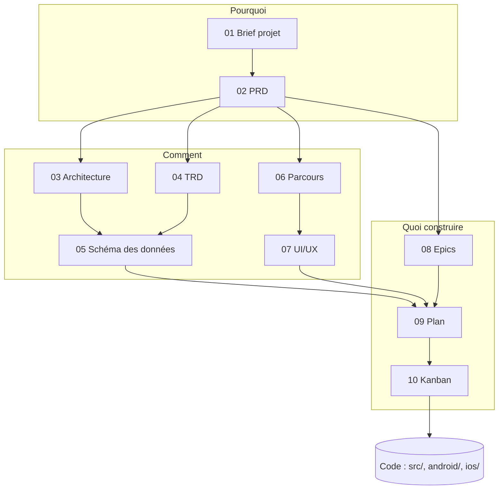
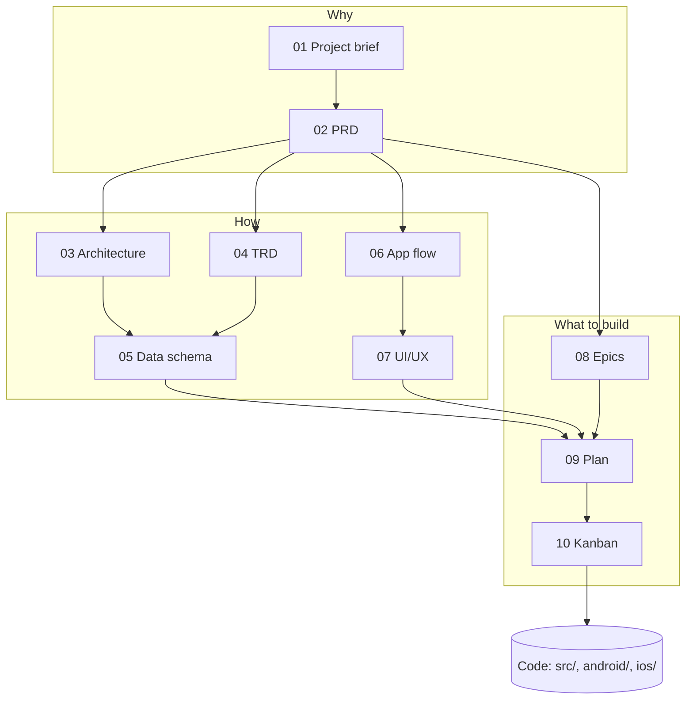

# Index de la documentation

Ce dossier contient les documents de conception de Pomodoro Accessibilité. Chaque document contient la version française, suivie de la traduction anglaise. Les documents se lisent dans l'ordre pour comprendre le projet, ou au cas par cas selon le besoin (voir « Par où commencer »).

## Documents

| N° | Document | Contenu |
| --- | --- | --- |
| 01 | [Brief projet](01_PROJECT_BRIEF.md) | Le contexte : problème, utilisateurs, objectif, périmètre, contraintes, risques et questions ouvertes. |
| 02 | [PRD](02_PRD.md) | Les exigences produit : utilisateurs, fonctionnalités avec leurs identifiants `EF-…`, règles métier, exigences non fonctionnelles et décisions. |
| 03 | [Architecture](03_ARCHITECTURE.md) | Comment les parties s'assemblent : découpage de `src/`, services, réactivité et points clés. |
| 04 | [TRD](04_TRD.md) | Les choix techniques : technologies, intégration native iOS et Android, build, intégration continue, sécurité et compromis. |
| 05 | [Schéma des données](05_DATA_SCHEMA.md) | Les types du domaine, les constantes et les clés de `localStorage` : l'application n'a pas de back end. |
| 06 | [Parcours de l'appli](06_APP_FLOW.md) | Les points d'entrée, les écrans et les parcours utilisateur. |
| 07 | [Design UI/UX](07_UI_UX_DESIGN.md) | Le public, le ton, le cadran, les thèmes, les sons, les langues, l'accessibilité et les icônes. |
| 08 | [Epics et user stories](08_EPICS.md) | Les epics et leurs stories, avec leurs identifiants `E<epic>-S<story>`. |
| 09 | [Plan d'implémentation](09_IMPLEMENTATION_PLAN.md) | L'ordre de construction, étape par étape, et ce qui reste à faire. |
| 10 | [Kanban](10_KANBAN.md) | La circulation du travail : colonnes, limites, définitions de prêt et de terminé. |

## Enchaînement des documents

Le schéma se lit de haut en bas : le brief cadre le PRD, le PRD donne les choix techniques, les écrans et les epics, puis le plan d'implémentation et le Kanban organisent le travail sur le code.

- **Pourquoi** (01, 02) : le problème, les utilisateurs et ce que fait le produit.
- **Comment** (03 à 07) : l'architecture, les choix techniques, les données, les écrans et l'interface.
- **Quoi construire** (08 à 10) : les stories, l'ordre des étapes et le suivi du travail.

## Par où commencer

- **Comprendre le projet** : 01, puis 02.
- **Développer une fonctionnalité** : 08 (la story et ses critères), puis 02 (l'exigence), 05 (les données), 06 (les écrans) et 07 (l'interface).
- **Comprendre la technique** : 03, puis 04.
- **Savoir quoi faire ensuite** : 09, puis 10.

## Règles de lecture

- En cas de conflit entre le code et ces documents, signaler l'écart avant de choisir.
- Le suivi du travail vit dans `ROADMAP.md` (points ouverts) et dans les issues GitHub ; les stories restent écrites dans le document des epics.
- Les installations et les commandes du quotidien sont dans le [TRD](04_TRD.md) ; le [README](../README.md) présente le produit.

 

  

 

# Documentation index

This folder holds the Pomodoro Accessibilité design documents. Each document contains the French version, followed by the English translation. Read them in order to understand the project, or one by one as needed (see "Where to start").

## Documents

| No. | Document | Contents |
| --- | --- | --- |
| 01 | [Project brief](01_PROJECT_BRIEF.md) | The context: problem, users, goal, scope, constraints, risks and open questions. |
| 02 | [PRD](02_PRD.md) | The product requirements: users, features with their `EF-…` identifiers, business rules, non-functional requirements and decisions. |
| 03 | [Architecture](03_ARCHITECTURE.md) | How the parts fit together: breakdown of `src/`, services, reactivity and key points. |
| 04 | [TRD](04_TRD.md) | The technical choices: technologies, iOS and Android native integration, build, continuous integration, security and trade-offs. |
| 05 | [Data schema](05_DATA_SCHEMA.md) | The domain types, the constants and the `localStorage` keys: the application has no back end. |
| 06 | [App flow](06_APP_FLOW.md) | The entry points, the screens and the user flows. |
| 07 | [UI/UX design](07_UI_UX_DESIGN.md) | The audience, tone, dial, themes, sounds, languages, accessibility and icons. |
| 08 | [Epics and user stories](08_EPICS.md) | The epics and their stories, with their `E<epic>-S<story>` identifiers. |
| 09 | [Implementation plan](09_IMPLEMENTATION_PLAN.md) | The build order, step by step, and what is left to do. |
| 10 | [Kanban](10_KANBAN.md) | How work flows: columns, limits, definitions of ready and done. |

## How the documents fit together

Read the diagram from top to bottom: the brief frames the PRD, the PRD leads to the technical choices, the screens and the epics, then the implementation plan and the Kanban organise the work on the code.

- **Why** (01, 02): the problem, the users and what the product does.
- **How** (03 to 07): the architecture, the technical choices, the data, the screens and the interface.
- **What to build** (08 to 10): the stories, the order of the steps and the tracking of work.

## Where to start

- **Understand the project**: 01, then 02.
- **Build a feature**: 08 (the story and its criteria), then 02 (the requirement), 05 (the data), 06 (the screens) and 07 (the interface).
- **Understand the technology**: 03, then 04.
- **Know what to do next**: 09, then 10.

## Reading rules

- If the code and these documents disagree, report the gap before choosing.
- Work tracking lives in `ROADMAP.md` (open items) and in GitHub issues; the stories stay written in the epics document.
- Installation and everyday commands are in the [TRD](04_TRD.md); the [README](../README.md) presents the product.
